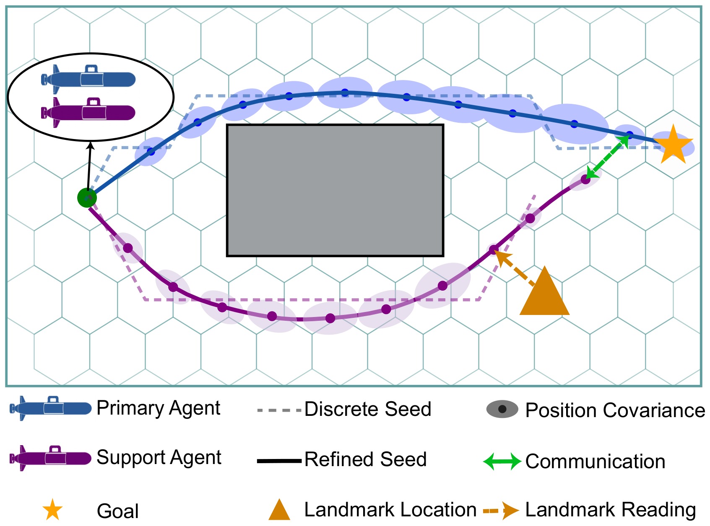

# CONSORT

### Uncertainty-Constrained Multi-Robot Planning for Cooperative Localization in GPS-Denied Environments

[Tony Zhang](https://www.linkedin.com/in/tony-hu-zhang)1,2,
[Ryan Bartholomew](https://sites.google.com/view/ryan-m-bartholomew)1,
[Kalliyan Velasco](https://frostlab.byu.edu/people/kalliyan-velasco/)1,
[Joshua Mangelson](https://frostlab.byu.edu/people/josh-mangelson/)1,
[Brady Moon](https://frostlab.byu.edu/people/brady-moon/)1

1[Brigham Young University](https://www.byu.edu/) &nbsp;&nbsp; 2[University of Utah](https://www.utah.edu/)

[FROST Lab](https://frostlab.byu.edu)

The support agent localizes with a landmark and relays position data, so the primary agent can take a more direct path to the goal.

---

CONSORT is a centralized planner for the escort problem. A primary agent must reach a goal in minimum time with its localization uncertainty under a terminal bound. Support agents have no goals of their own and are routed only to keep the primary's uncertainty under that bound. CONSORT optimizes over the agents' mean trajectories and propagates covariance along them only to evaluate the constraints. It first searches a heading-aware hexagonal lattice jointly over all agents, then refines the result into B-spline trajectories. Both stages enforce the curvature bound, chance-constrained obstacle avoidance, and the terminal uncertainty bound.

## Repository layout

| Path | Contents |
|---|---|
| [`code/`](code/) | The Julia planner (CONSORT and the four baselines), the HoloOcean simulator, the experiment drivers, and the data behind every figure in the paper. See [`code/README.md`](code/README.md) for setup and how to reproduce the results. |
| [`website/`](website/) | The project page: Astro and Tailwind CSS, deployed to GitHub Pages. See [`website/README.md`](website/README.md). |

## Citation

If you use this code, please cite the paper. The BibTeX entry is on the [project page](https://frostlab.byu.edu/consort-planner/#bibtex).
